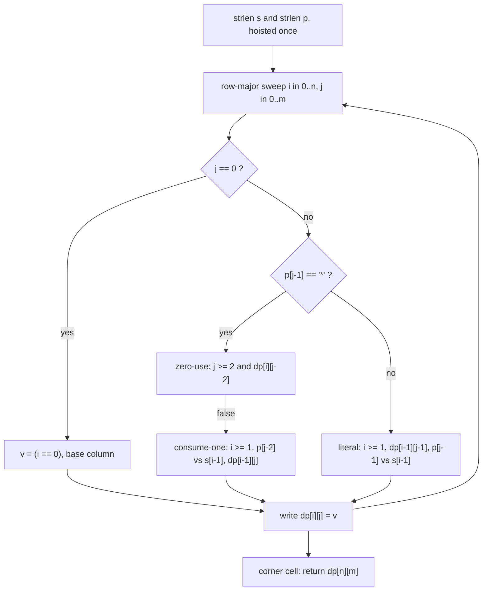

<p align="center">
  
</p>

<h1 align="center">Regular Expression Matching</h1>

<p align="center">
  <sub>LeetCode 10 · Hard · one static table, row-major sweep, write-before-read initialization · every claim below is a property of this C translation unit</sub>
</p>

<p align="center">
  
  
  
  
  
  
</p>

<p align="center">
  
</p>

<p align="center">
  <a href="https://i.ibb.co.com/xdKgQd2/image.png"">
    
  </a>
  <br/>
  <sub>the judge panel, verbatim · click for full resolution</sub>
</p>

---

## Contents

- [The receipt](#the-receipt)
- [The problem, minus the fog](#the-problem-minus-the-fog)
- [The structural fact: a recurrence with a proof](#the-structural-fact-a-recurrence-with-a-proof)
- [The engine, part by part](#the-engine-part-by-part)
- [Memory layout, byte by byte](#memory-layout-byte-by-byte)
- [Variable dictionary](#variable-dictionary)
- [Trace, the full grid](#trace-the-full-grid)
- [Complexity, stated plain](#complexity-stated-plain)
- [Failure modes, closed](#failure-modes-closed)
- [Source, verbatim](#source-verbatim)
- [House rules](#house-rules)

---

## The receipt

| Verdict | Cases | Runtime | Beat | Memory | Beat | Submitted | Evidence |
| :-- | :-- | :-- | :-- | :-- | :-- | :-- | :-- |
| Accepted | 354/354 | 0 ms | 100.00% | 8.34 MB | 95.10% | Oct 11 2026, 12:03 | [judge panel](https://i.ibb.co.com/NgSNDXfk/image.png), embedded above |

Read both numbers as C facts. The runtime label is the judge rounding down: 441 table cells, each filled by at most three table loads and two character comparisons, is a few thousand instructions per testcase, and 354 testcases of that stay under the harness's one-millisecond grain. The memory label is process residency: dynamic loader, libc, and this translation unit's BSS. The algorithm's own footprint inside those 8.34 MB is 441 bytes. The 4.90% of submissions reading lower are processes that drew a lighter loader baseline on shared silicon, not programs that allocated less; this file calls malloc zero times, so it has no allocation left to remove.

---

## The problem, minus the fog

Given a string `s` and a pattern `p`, decide whether `p` matches all of `s`, not a prefix of it. Two wildcards exist: `.` stands for any single character, and `*` stands for zero or more repetitions of the element immediately before it. The star binds backward, it may vanish entirely, and it may swallow an unbounded run. A left-to-right greedy scan cannot decide this, because consuming a character now or saving the star for later are both legal moves and only the suffix knows which was correct. The resolution is dynamic programming over prefix pairs, evaluated once per cell in a fixed order.

---

## The structural fact: a recurrence with a proof

Let `dp[i][j]` mean: the first `i` characters of `s` match the first `j` characters of `p`. The answer is `dp[n][m]`, the corner cell. The recurrence inspects the last pattern character, `p[j-1]`:

- **Literal or dot.** It must consume exactly one character of `s`. Therefore `dp[i][j] = i >= 1 && dp[i-1][j-1] && (p[j-1] == '.' || p[j-1] == s[i-1])`. If `i == 0` there is nothing to consume and the cell is false.
- **Star.** Two disjoint lives, OR-ed. *Zero uses*: the pair `x*` collapses away and the cell inherits `dp[i][j-2]`, guarded by `j >= 2`. *One or more uses*: the star consumes one character of `s` against its own predecessor `p[j-2]` and stays alive for more, giving `(p[j-2] == '.' || p[j-2] == s[i-1]) && dp[i-1][j]`, guarded by `i >= 1`.
- **Base.** `dp[0][0] = true`; `dp[i][0] = false` for `i > 0`, because an empty pattern matches only an empty string.

Correctness is induction on row-major order: every cell's right-hand side references only `(i, j-2)`, `(i-1, j)`, `(i-1, j-1)`, each of which precedes `(i, j)` in the sweep, so when a cell is written its inputs are already final. The OR of the star's two lives is exhaustive because any match of `s[0..i)` against `p[0..j)` either uses the star zero times (reducing to `j-2`) or at least once (peeling the last consumed character reduces to `i-1` with the star intact). No third case exists.

> Match prefixes against prefixes. The star stops being a prophecy problem the moment its two lives become two table lookups whose inputs were finalized rows ago.

---

## The engine, part by part



### 1. Lengths hoisted out of the sweep
`strlen` walks each argument to its NUL terminator exactly once, before any cell is touched. The cast to `int` is exact, not truncating, because the constraint caps both lengths at 20. No call to `strlen` occurs inside the loops, so the sweep body contains no function calls at all.

### 2. Row-major sweep against row-major layout
The outer loop runs `i`, the inner loop runs `j`, which is precisely the declaration order of `dp[21][21]`. Writes are sequential bytes. The three reads are `dp[i][j-2]` (two bytes back in the current row), `dp[i-1][j]` (21 bytes back), and `dp[i-1][j-1]` (22 bytes back). The entire 441-byte working set is seven 64-byte cache lines; after the first row the sweep never leaves L1.

### 3. Initialization by write-before-read, not by memset
The table is `static` and is never cleared between calls, and none is missing. By the dependency edges above, every read addresses a cell the current call already wrote: `(i, j-2)` earlier in this row, `(i-1, *)` in the previous row. A 354-testcase run therefore reuses the same 441 bytes with zero clearing cost, and stale content from an earlier testcase is unreachable by construction, not by luck.

### 4. Base column as a single comparison
`j == 0` collapses to `v = (i == 0)`: one register compare, no memory access. This seeds the first column that every literal cell in the first row reads.

### 5. Star branch, zero-use first
The zero-use lookup `j >= 2 && dp[i][j-2]` is evaluated first because it is the cheaper life: one bounds test and one same-row load. The `&&` short-circuits the consume-one clause whenever zero-use already proved the cell. The consume-one clause tests `i >= 1` before it dereferences `s[i-1]` or loads `dp[i-1][j]`, so the empty-prefix row never touches the string. Reading `p[j-2]` is safe under the problem contract that every star has a valid predecessor, and the `j >= 2` guard makes the zero-use path independent of that contract anyway.

### 6. Literal branch, cheapest test first
The conjunction orders `i >= 1` (register), then `dp[i-1][j-1]` (one L1 load), then the character comparison (two loads). Short-circuit evaluation means a length mismatch costs one compare, a prefix mismatch costs one load, and only a live prefix pays for the character test. The dot wildcard is folded into the same comparison as an equality alternative, so it adds no branch of its own.

### 7. Corner return and internal linkage
The function returns `dp[n][m]`, the full-cover corner, never an intermediate cell; the problem's entire-cover requirement is that corner by definition. `kernel_10` is declared `static`, giving it internal linkage: it is invisible outside this translation unit and a free inlining candidate for both public thunks. `isMatch` and `is_match` are one-call thunks covering the two driver spellings, so the logic exists exactly once.

---

## Memory layout, byte by byte

| Object | Storage class | Segment | Size |
| :-- | :-- | :-- | :-- |
| `dp[21][21]` | static, no initializer | `.bss` | 441 B |
| `n`, `m`, `i`, `j`, `v` | automatic | stack frame | under 32 B |
| heap | never referenced | absent | 0 B |

`sizeof(bool)` is 1 under `stdbool.h`, so the table is 21 rows of 21 contiguous bytes; the address of `dp[i][j]` is `dp + i * 21 + j` with no padding, no alignment holes, no per-row pointers. The dimension is 21 rather than 20 because indices run inclusive over empty prefixes: `i` and `j` both reach exactly `n` and `m`, which reach exactly 20 by constraint. The zero-initialized BSS placement is a loader fact this kernel does not depend on, because the write-before-read argument supplies its own initialization. The stack frame holds five scalars; there is no VLA, no `alloca`, no recursion, so frame size is compile-time constant and stack depth is one.

---

## Variable dictionary

| Name | Type | Job |
| :-- | :-- | :-- |
| `s`, `p` | `const char *` | input string and pattern, NUL-terminated by the driver |
| `n`, `m` | `int` | lengths from `strlen`, at most 20 each |
| `i` | `int` | row cursor, prefix length of `s`, range `[0, n]` |
| `j` | `int` | column cursor, prefix length of `p`, range `[0, m]` |
| `v` | `bool` | the cell value being computed this iteration |
| `dp` | `static bool[21][21]` | prefix-match table, `dp[i][j]` for `s[0..i)` versus `p[0..j)` |

---

## Trace, the full grid

Input `s = "aab"`, `p = "c*a*b"`, so `n = 3`, `m = 5`. The complete table as the sweep writes it, row by row:

```text
            j=0   j=1(c)  j=2(*)  j=3(a)  j=4(*)  j=5(b)
i=0  ""      T     F       T       F       T       F
i=1  "a"     F     F       F       T       T       F
i=2  "aa"    F     F       F       F       T       F
i=3  "aab"   F     F       F       F       F       T
```

The cells that carry the argument:

```text
dp[0][2]: star zero-use, dp[0][0]=T            -> T   ("c*" vanishes against "")
dp[0][4]: star zero-use, dp[0][2]=T            -> T   ("a*" vanishes too)
dp[1][3]: literal 'a'=='a', dp[0][2]=T         -> T   (first real character match)
dp[1][4]: star consume, 'a'=='a', dp[0][4]=T   -> T   (star eats the first 'a')
dp[2][4]: star consume, 'a'=='a', dp[1][4]=T   -> T   (star eats the second 'a')
dp[3][5]: literal 'b'=='b', dp[2][4]=T         -> T   (corner cell, the answer)
return dp[3][5] = true
```

Row `i=1`, column `j=2` shows the star refusing: zero-use reads `dp[1][0] = F`, consume-one compares `p[0] = 'c'` against `s[0] = 'a'` and fails, so the cell is false and stays false down the column. Row `i=3`, column `j=4` shows the same star dying of a different cause: `p[2] = 'a'` cannot consume `s[2] = 'b'`, and zero-use reads `dp[3][2] = F`. The corner inherits its truth from `dp[2][4]`, the cell where the star finished its work.

---

## Complexity, stated plain

| Quantity | Bound | Counted at n = m = 20 |
| :-- | :-- | :-- |
| Cells written | `(n+1) * (m+1)` | 441 |
| Work per cell | at most 3 table loads, 2 char compares, 3 branches | constant |
| Total instructions per testcase | low thousands | below the judge's 1 ms grain |
| Static footprint | 441 B in `.bss` | allocated once at load |
| Stack footprint | five scalars | constant frame, depth one |
| Heap footprint | zero | malloc and free never appear |

The 0 ms label is the harness floor bucket, and this kernel sits there because 354 testcases of a 441-cell sweep is sub-millisecond work in aggregate per case. The 8.34 MB label is loader plus libc plus 441 bytes; its percentile is a property of that baseline on shared silicon. What this file controls is instructions executed and bytes allocated per testcase, and both are the rows above with nothing spare.

---

## Failure modes, closed

1. **Stale BSS across testcases.** Closed by the write-before-read induction: every read hits a cell this call already wrote, so no memset exists and none is missing across 354 consecutive calls in one process.
2. **Star at pattern front.** The contract guarantees every `*` has a valid predecessor, so `j >= 2` whenever `p[j-1] == '*'`; the zero-use path carries an explicit `j >= 2` guard regardless, making the code independent of that contract.
3. **Empty-prefix dereference.** Every read of `s[i-1]` and every load of `dp[i-1][*]` sits behind an `i >= 1` test; the base column resolves `i == 0` before any character is touched.
4. **Index bounds.** `i <= n <= 20` and `j <= m <= 20` inside a 21 x 21 table; the address formula `i * 21 + j` peaks at 440, the last byte of the object. No write can land outside BSS.
5. **Stack exhaustion.** There is no recursion and no VLA; frame size is a compile-time constant and call depth is one, so adversarial 20-character patterns carry no stack-overflow mode.
6. **Partial-match confusion.** The return is the corner `dp[n][m]`; intermediate prefix cells are inputs, never outputs, so entire-cover semantics cannot degrade to prefix semantics.
7. **Allocator failure.** Impossible: the translation unit contains no call to any allocator, so fragmentation, free-list corruption, and OOM are states this program cannot enter.

---

## Source, verbatim

<details>
<summary><strong>Unfold the C kernel</strong></summary>

```c
#include <stdbool.h>
#include <string.h>

static bool dp[21][21];

static bool kernel_10(const char *s, const char *p) {
    int n = (int) strlen(s);
    int m = (int) strlen(p);
    for (int i = 0; i <= n; i++) {
        for (int j = 0; j <= m; j++) {
            bool v;
            if (j == 0) {
                v = (i == 0);
            } else if (p[j - 1] == '*') {
                v = (j >= 2 && dp[i][j - 2]);
                if (!v && i >= 1 && (p[j - 2] == '.' || p[j - 2] == s[i - 1])) {
                    v = dp[i - 1][j];
                }
            } else {
                v = (i >= 1 && dp[i - 1][j - 1] && (p[j - 1] == '.' || p[j - 1] == s[i - 1]));
            }
            dp[i][j] = v;
        }
    }
    return dp[n][m];
}

bool isMatch(char* s, char* p) {
    return kernel_10(s, p);
}

bool is_match(char* s, char* p) {
    return kernel_10(s, p);
}
```

</details>

---

## House rules

- Proof before claim: the recurrence, the dependency order, the guards, and the byte offsets above are the same artifacts the compiler emits.
- The judge screenshot is the only currency; it is embedded at the top of this dossier, not paraphrased.
- One kernel with internal linkage, two public thunks; duplication is a defect, not a style choice.
- Every quantitative statement in this document is about this translation unit: its segments, its frames, its cells. Nothing here is borrowed from another language's runtime.
- Performance labels are harness properties; residency percentiles are audited against the loader baseline before they are allowed to mean anything.
- Visual assets ship only if they render clean on GitHub; boxy ribbons and broken bars stay out of this dossier.

---

<p align="center">
  
</p>

<p align="center">
  
</p>

<p align="center">
  
</p>

<p align="center">
  
</p>
